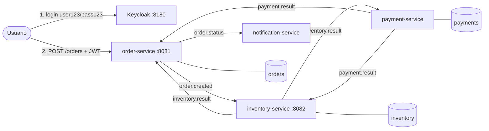

# Kafka Order Saga 🛒

Sistema de pedidos de e-commerce con **microservicios orientados a eventos**:
**Apache Kafka · Java 21 · Spring Boot 3 · PostgreSQL · Keycloak (OAuth2) · Docker**.

Implementa el **patrón Saga (coreografía)** con compensación, el **patrón Transactional Outbox**, **arquitectura hexagonal + DDD** y una API protegida con **OAuth2/JWT**.

## 🔑 Pruébalo: usuario demo

| Usuario | Contraseña | Para qué |
|---|---|---|
| **`user123`** | **`pass123`** | Usuario normal para probar la API |
| `boom` | `boom123` | Simula una pasarela de pago caída (sus pedidos acaban en el Dead Letter Topic) |
| `admin` | `admin` | Consola de administración de Keycloak: http://localhost:8180 |

> Son credenciales de demo que solo existen en el Keycloak que levantas en tu máquina con Docker.

## Arquitectura



| Servicio | Consume | Publica | Base de datos |
|---|---|---|---|
| **order-service** | `inventory.result`, `payment.result` | `order.created`, `order.status` | `orders` |
| **inventory-service** | `order.created`, `payment.result` | `inventory.result` | `inventory` |
| **payment-service** | `inventory.result` | `payment.result` | `payments` |
| **notification-service** | `order.status` | – | – |

### Flujos

- ✅ **Camino feliz**: pedido → stock reservado → pago OK → `CONFIRMED`
- ❌ **Sin stock**: pedido → stock rechazado → `CANCELLED`
- 🔁 **Compensación**: stock reservado → pago rechazado (importe > 1000) → inventario **devuelve el stock** → `CANCELLED`
- ☠️ **Error técnico**: la pasarela falla → 2 reintentos → **Dead Letter Topic** `inventory.result-dlt` → `payment-service` lo consume, da el pago por fallido → el stock vuelve → `CANCELLED`

### Arquitectura hexagonal en cada servicio

```
order-service/src/main/java/com/ruben/shop/order/
├── domain/            ← Java puro: agregado Order, value objects (OrderId, Money), eventos de dominio, puertos
├── application/       ← casos de uso (OrderService) y puertos de salida (OrderEventPublisher)
└── infrastructure/
    ├── web/           ← adaptador de entrada HTTP + seguridad OAuth2
    ├── messaging/     ← adaptador de entrada Kafka + adaptador de salida a la outbox
    └── persistence/   ← adaptador de salida JPA (entidades JPA separadas del dominio)
```

Las dependencias solo apuntan hacia dentro: `infrastructure → application → domain`. Lo comprueba un **test de ArchUnit** en cada build. Si alguien importa Spring, JPA o Kafka en el dominio, el build falla.

## Cómo arrancarlo

Requisitos: **Docker** y Docker Compose.

```bash
docker compose up --build
```

| URL | Qué es |
|---|---|
| http://localhost:8081/orders | API de pedidos (requiere token) |
| http://localhost:8082/stock | Stock (público) |
| http://localhost:8180 | Keycloak (admin / admin) |
| http://localhost:8080 | Kafka UI: topics, mensajes, consumer groups, lag |
| http://localhost:8085 | Adminer: ver las tablas (servidor `postgres`, usuario/clave `shop`/`shop`) |

Stock inicial: `LAPTOP=10`, `PHONE=5`, `MOUSE=100`.

## Demo

### 1. Login (obtener el token)

**bash:**
```bash
TOKEN=$(curl -s -X POST localhost:8180/realms/shop/protocol/openid-connect/token \
  -d grant_type=password -d client_id=shop-client \
  -d username=user123 -d password=pass123 | jq -r .access_token)
```

**PowerShell:**
```powershell
$TOKEN = (Invoke-RestMethod -Method Post -Uri http://localhost:8180/realms/shop/protocol/openid-connect/token `
  -Body @{grant_type='password'; client_id='shop-client'; username='user123'; password='pass123'}).access_token
```

### 2. Crear pedidos

El cliente del pedido **sale del token**: nadie puede comprar en nombre de otro.

```bash
# Camino feliz → CONFIRMED
curl -X POST localhost:8081/orders -H "Authorization: Bearer $TOKEN" -H "Content-Type: application/json" \
  -d '{"productId":"LAPTOP","quantity":1,"amount":900}'

# Sin stock → CANCELLED
curl -X POST localhost:8081/orders -H "Authorization: Bearer $TOKEN" -H "Content-Type: application/json" \
  -d '{"productId":"PHONE","quantity":50,"amount":100}'

# Pago rechazado → CANCELLED y el stock vuelve (mira /stock antes y después)
curl -X POST localhost:8081/orders -H "Authorization: Bearer $TOKEN" -H "Content-Type: application/json" \
  -d '{"productId":"LAPTOP","quantity":2,"amount":5000}'

# Tus pedidos (solo ves los tuyos)
curl localhost:8081/orders -H "Authorization: Bearer $TOKEN"

# Sin token → 401
curl -i localhost:8081/orders
```

### 3. Error técnico y Dead Letter Topic

Haz login con `boom` / `boom123` y crea un pedido. La pasarela simulada falla, Kafka reintenta 2 veces y el mensaje acaba en `inventory.result-dlt` (míralo en Kafka UI). `payment-service` escucha ese DLT y publica el pago como fallido ("Pasarela de pago no disponible"), así que la saga compensa: el pedido termina `CANCELLED` y el stock vuelve. El mensaje se queda en el DLT como registro.

### 4. El patrón Outbox en acción: apaga Kafka

```bash
docker compose stop kafka
# Crea un pedido: la API responde 202, el pedido se guarda y su evento queda pendiente en la tabla outbox_event
docker compose start kafka
# En unos segundos el evento se publica solo y el pedido termina CONFIRMED. No se ha perdido nada.
```

### 5. Poison pill

Un mensaje corrupto va directo a `order.created-dlt` sin bloquear al consumidor:

```bash
docker exec -it kafka /opt/kafka/bin/kafka-console-producer.sh --bootstrap-server localhost:9092 --topic order.created
> esto no es json
```

Logs de los "emails": `docker compose logs -f notification-service`

## Qué demuestra

### Kafka
| Concepto | Dónde |
|---|---|
| **Clave de partición = `orderId`** | Todos los eventos de un pedido van a la misma partición y se procesan en orden |
| **Topics con 3 particiones** | `KafkaCommonConfig`: hasta 3 instancias por consumer group |
| **Consumer groups** | `inventory.result` lo leen `order-service` y `payment-service`, y cada grupo recibe todos los mensajes |
| **Productor idempotente + `acks=all`** | `kafka-common.yml` |
| **Consumidores idempotentes** | Kafka entrega *at-least-once*: la PK de cada tabla y las reglas del agregado ignoran los duplicados |
| **Reintentos + Dead Letter Topic** | `DefaultErrorHandler` + `DeadLetterPublishingRecoverer` |
| **Consumidor del DLT** | `DeadLetterListener` en `payment-service`: convierte un cobro abandonado en compensación |
| **Poison pills** | `ErrorHandlingDeserializer` |
| **KRaft** | Kafka sin Zookeeper |

### Diseño
| Concepto | Dónde |
|---|---|
| **Saga con compensación** | Si el pago falla, `inventory-service` devuelve el stock |
| **Transactional Outbox** | Módulo `outbox`: el cambio de negocio y el evento se guardan en la misma transacción. `OutboxPublisher` los envía a Kafka con `FOR UPDATE SKIP LOCKED` |
| **DDD** | Agregados con comportamiento (`Order.confirm()`, `Product.reserve()`, `Payment.authorize()`), value objects (`Money`, `OrderId`), eventos de dominio que se traducen a eventos de integración |
| **Arquitectura hexagonal** | Puertos en `domain`/`application` y adaptadores en `infrastructure`, verificados con ArchUnit |
| **Database per service** | Cada servicio es dueño de su base de datos. Esquema versionado con **Flyway** |
| **Optimistic locking** | `@Version` en las entidades: si hay escrituras concurrentes, una falla y Kafka la reintenta |
| **OAuth2 / OIDC** | Keycloak emite JWT y `order-service` es un *resource server* que valida firma, issuer y expiración |

## Decisiones técnicas

- **Coreografía en vez de orquestación**: con 4 servicios, cada uno reacciona a eventos sin un coordinador central.
- **Eventos de dominio ≠ eventos de integración**: el dominio emite `OrderPlaced`/`OrderConfirmed`, y un adaptador los traduce a los contratos públicos del módulo `common`. El modelo interno puede cambiar sin romper a los consumidores.
- **Entidades JPA separadas del dominio**: más código de mapeo a cambio de un dominio testeable en milisegundos y sin anotaciones de framework.
- **Error de negocio ≠ error técnico**: "sin stock" o "pago rechazado" son eventos normales de la saga, mientras que una excepción de la pasarela va a reintentos y al DLT. Al agotar los reintentos, el consumidor del DLT la convierte en un rechazo para que la saga no se quede a medias.
- **Password grant solo para la demo**: permite obtener un token con un `curl`. Un frontend real usaría Authorization Code + PKCE.
- **JSON con cabeceras de tipo**: simple para empezar. En producción usaría Avro + Schema Registry.

## Limitaciones conocidas (siguientes pasos)

- Un pedido que falla en otros pasos (p. ej. `order-service` sin base de datos al cancelar) sigue quedándose `PENDING` en su DLT. Faltaría un timeout general de la saga.
- Con una pasarela real, antes de dar un cobro por fallido habría que consultarlo por `orderId` (clave de idempotencia): el cargo pudo entrar aunque fallara el commit.
- La outbox se lee por *polling* cada 500 ms. Con mucho volumen, conviene CDC con Debezium.
- La tabla `outbox_event` no se purga. Falta un job de limpieza de eventos enviados.
- Tests de integración con Testcontainers (Kafka y Postgres reales) y métricas de consumer lag con Prometheus + Grafana.

## Tests

```bash
mvn verify   # requiere JDK 21; no necesita Docker (usa H2 en modo PostgreSQL)
```

41 tests: dominio puro, casos de uso con JPA + outbox, seguridad del API, publicación de la outbox y reglas de arquitectura.

## Estructura

```
├── common/                 # contratos de eventos (integration events), topics y config Kafka (DLT, reintentos)
├── outbox/                 # Transactional Outbox reutilizable + config de persistencia común
├── order-service/          # API REST segura + agregado Order
├── inventory-service/      # agregados Product y Reservation, compensación
├── payment-service/        # agregado Payment + pasarela simulada
├── notification-service/   # notificaciones (log)
├── docker/                 # init de Postgres y realm de Keycloak con los usuarios demo
├── Dockerfile              # build multi-stage, un único Dockerfile para todos los servicios
└── docker-compose.yml      # Kafka (KRaft) + Postgres + Keycloak + Kafka UI + Adminer + 4 servicios
```
