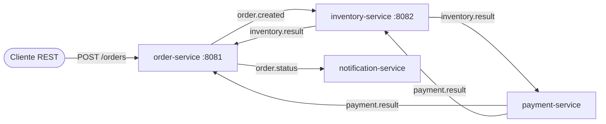

# Kafka Order Saga 🛒

Sistema de pedidos de e-commerce basado en **microservicios orientados a eventos** con **Apache Kafka**, **Java 21** y **Spring Boot 3**.
Implementa el **patrón Saga (coreografía)**: no hay transacción distribuida. Cada servicio reacciona a eventos y, si algo falla, se **compensa** lo que ya se había hecho.

## Arquitectura



| Servicio | Consume | Publica | Responsabilidad |
|---|---|---|---|
| **order-service** | `inventory.result`, `payment.result` | `order.created`, `order.status` | API REST, estado del pedido |
| **inventory-service** | `order.created`, `payment.result` | `inventory.result` | Reserva stock y lo libera si el pago falla |
| **payment-service** | `inventory.result` | `payment.result` | Simula la pasarela de pago |
| **notification-service** | `order.status` | – | "Envía" emails (log) |

### Flujos

- ✅ **Camino feliz**: pedido → stock reservado → pago OK → `CONFIRMED`
- ❌ **Sin stock**: pedido → stock rechazado → `CANCELLED`
- 🔁 **Compensación**: pedido → stock reservado → pago rechazado (importe > 1000) → inventario **libera el stock** → `CANCELLED`
- ☠️ **Error técnico**: payment lanza una excepción → 2 reintentos → el mensaje va al **Dead Letter Topic** `inventory.result-dlt`

## Cómo arrancarlo

Requisitos: **Docker** y Docker Compose.

```bash
docker compose up --build
```

- Kafka UI: http://localhost:8080 (topics, mensajes, consumer groups y lag)
- Order API: http://localhost:8081/orders
- Stock: http://localhost:8082/stock

Stock inicial: `LAPTOP=10`, `PHONE=5`, `MOUSE=100`.

## Demo

```bash
# 1. Camino feliz → CONFIRMED
curl -X POST localhost:8081/orders -H "Content-Type: application/json" \
  -d '{"customerId":"ana","productId":"LAPTOP","quantity":1,"amount":900}'

# 2. Sin stock → CANCELLED
curl -X POST localhost:8081/orders -H "Content-Type: application/json" \
  -d '{"customerId":"luis","productId":"PHONE","quantity":50,"amount":100}'

# 3. Pago rechazado → CANCELLED y el stock vuelve (mira /stock antes y después)
curl -X POST localhost:8081/orders -H "Content-Type: application/json" \
  -d '{"customerId":"eva","productId":"LAPTOP","quantity":2,"amount":5000}'

# 4. Error técnico → reintentos y mensaje en inventory.result-dlt (míralo en Kafka UI)
curl -X POST localhost:8081/orders -H "Content-Type: application/json" \
  -d '{"customerId":"boom","productId":"MOUSE","quantity":1,"amount":10}'

# Estado de los pedidos y del stock
curl localhost:8081/orders
curl localhost:8082/stock

# Logs de los emails
docker compose logs -f notification-service
```

**Poison pill** (mensaje que no se puede deserializar → va directo a `order.created-dlt` sin bloquear el consumidor):

```bash
docker exec -it kafka /opt/kafka/bin/kafka-console-producer.sh \
  --bootstrap-server localhost:9092 --topic order.created
> esto no es json
```

## Conceptos de Kafka que demuestra

| Concepto | Dónde |
|---|---|
| **Clave de partición = `orderId`** | Todos los eventos de un pedido van a la misma partición, así que se procesan **en orden** |
| **Topics con 3 particiones** | `KafkaCommonConfig`: permite escalar cada servicio hasta 3 instancias por consumer group |
| **Consumer groups** | `inventory.result` lo leen `order-service` y `payment-service`: cada grupo recibe **todos** los mensajes (pub/sub) |
| **Productor idempotente + `acks=all`** | `kafka-common.yml`: sin duplicados por reintentos del productor y sin pérdida si cae el líder |
| **Consumidores idempotentes** | Kafka entrega *at-least-once*: inventario y pagos ignoran eventos repetidos y el pedido solo sale de `PENDING` una vez |
| **Reintentos + Dead Letter Topic** | `DefaultErrorHandler` + `DeadLetterPublishingRecoverer`: 2 reintentos y después a `<topic>-dlt` |
| **Poison pills** | `ErrorHandlingDeserializer`: un mensaje corrupto va al DLT en lugar de bloquear la partición |
| **Saga con compensación** | Si el pago falla, `inventory-service` devuelve el stock reservado |
| **KRaft** | Kafka sin Zookeeper (`docker-compose.yml`) |

## Decisiones técnicas

- **Coreografía en vez de orquestación**: con 4 servicios, cada uno reacciona a eventos sin un coordinador central. Si el flujo creciera mucho, pasaría a un orquestador (por ejemplo, un servicio dedicado o Temporal).
- **Los eventos llevan los datos que necesita el siguiente paso** (`InventoryResult` incluye `amount` y `customerId`), así payment-service no hace llamadas síncronas a otros servicios.
- **JSON con cabeceras de tipo** de Spring Kafka, con los eventos compartidos en el módulo `common`. Es lo más simple para empezar; en producción usaría Avro + Schema Registry para la evolución de esquemas.
- **Error de negocio ≠ error técnico**: "sin stock" o "pago rechazado" son eventos normales de la saga; una excepción es un fallo técnico y va a reintentos y DLT.

## Limitaciones conocidas (siguientes pasos)

- **Estado en memoria**: los servicios pierden su estado al reiniciar. Siguiente paso: Postgres por servicio.
- **Dual write en order-service**: guarda el pedido y publica en Kafka sin atomicidad. Solución: **patrón Outbox** (+ Debezium).
- **Mensajes en el DLT**: un pedido cuyo pago acaba en el DLT queda `PENDING` con el stock reservado hasta que alguien reprocese el DLT. Falta un proceso de reprocesado o un timeout de la saga.
- Tests de integración con **Testcontainers** (Kafka real) y métricas de consumer lag con Prometheus + Grafana.

## Estructura

```
├── common/                 # eventos, topics y config Kafka compartida (DLT, reintentos)
├── order-service/          # API REST + estado del pedido
├── inventory-service/      # stock y compensación
├── payment-service/        # pasarela simulada
├── notification-service/   # notificaciones
├── Dockerfile              # build multi-stage, un único Dockerfile para todos los servicios
└── docker-compose.yml      # Kafka (KRaft) + Kafka UI + 4 servicios
```

Tests unitarios: `mvn verify` (requiere JDK 21).
